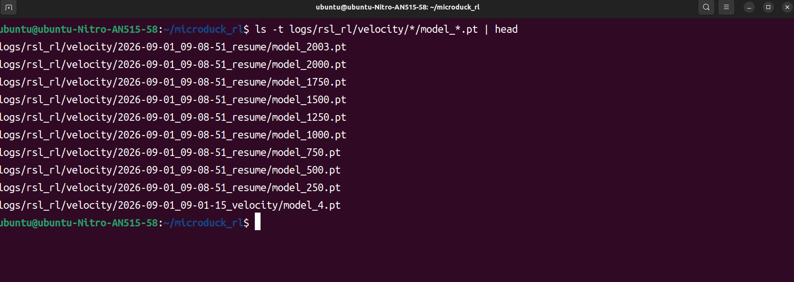
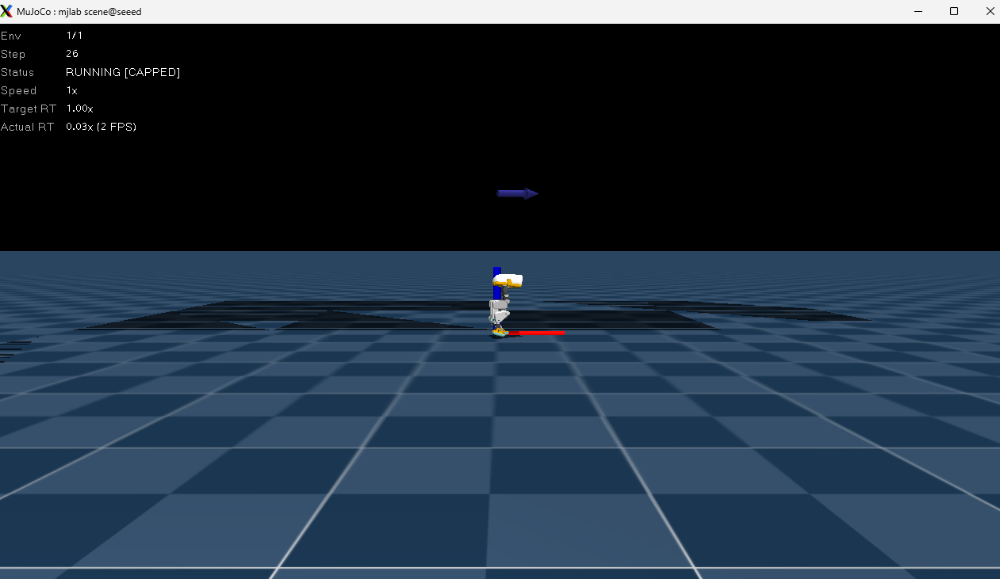

# microduck完整训练教程

QQ群：964821271（群1已满）

1082720345（群2）

加入QQ群，属于microduck的根据地，我们会同步更新microduck的国内上架进度，同时有遇到任何训练中的困难都可以在群里提出交流


**只要你有一台带显卡的设备，无论显卡有多低端，都可以训练属于自己的小鸭子**


## 下载uv,如未安装

```Plain Text
curl -LsSf https://astral.sh/uv/install.sh | sh
```

```Plain Text
source "$HOME/.local/bin/env"
```


## 安装环境

```Plain Text
git clone https://github.com/pollen-robotics/microduck_rl.git
```

```Plain Text
cd ~/microduck_rl
```

```Plain Text
export UV_HTTP_TIMEOUT=600
```

```Plain Text
uv sync

//网速慢的话可以更换镜像
uv sync --default-index https://mirrors.aliyun.com/pypi/simple/      //尝试阿里云镜像
```


## （可选）可以查看训练曲线

登陆https://wandb\.ai/注册自己的账号

创建并且拿到key之后终端输入

```Plain Text
uv run wandb login
```

将key输入回车

之后在你训练的时候打开这个网址即可点击正在训练的项目进行查看训练图像曲线


## 体验官方训练模型的步态效果

cd \~/microduck\_rl

下载

```Plain Text
curl -L -o alpha_walking.onnx \
  https://raw.githubusercontent.com/pollen-robotics/microduck/main/policies/alpha_walking.onnx
```

简单体验运行

```Plain Text
uv run scripts/infer_policy.py --walking alpha_walking.onnx --new-cmd-obs
```


想连坐下、翻滚一起看：

```Plain Text
curl -L -o alpha_sitstand.onnx \
  https://raw.githubusercontent.com/pollen-robotics/microduck/main/policies/alpha_sitstand.onnx
```

```Plain Text
curl -L -o roulade.onnx \
  https://raw.githubusercontent.com/pollen-robotics/microduck/main/policies/roulade.onnx
```

```Plain Text
uv run scripts/infer_policy.py \
  --walking alpha_walking.onnx \
  --sitstand alpha_sitstand.onnx \
  --roulade roulade.onnx \
  --new-cmd-obs
```

Y 坐下/站起，R 翻滚。

A / E：左转 / 右转

方向键上/下：前进/后退

空格：清零指令

注意，这些需要在终端上输入


轮滑、踢球下载

```Plain Text
curl -L -o roller.onnx \
  https://raw.githubusercontent.com/pollen-robotics/microduck/main/policies/roller.onnx
curl -L -o ball_kick_left.onnx \
  https://raw.githubusercontent.com/pollen-robotics/microduck/main/policies/ball_kick_left.onnx
curl -L -o ball_kick_right.onnx \
  https://raw.githubusercontent.com/pollen-robotics/microduck/main/policies/ball_kick_right.onnx
curl -L -o alpha_walking.onnx \
  https://raw.githubusercontent.com/pollen-robotics/microduck/main/policies/alpha_walking.onnx
```


踢球

`K` 左脚踢球

```Plain Text
uv run scripts/infer_policy.py \
  --walking alpha_walking.onnx \
  --kick-left ball_kick_left.onnx \
  --kick-right ball_kick_right.onnx \
  --new-cmd-obs
```

轮滑

```Plain Text
uv run scripts/infer_policy.py \
  --walking roller.onnx \
  --roller \
  --new-cmd-obs
```


## 跑通测试

查看自己是否能跑通，会使用创建64个环境，每个环境一只鸭子，训练5轮，但凡有显卡这条指令都能正常跑

```Plain Text
uv run train Mjlab-Velocity-Flat-MicroDuck \
  --env.scene.num-envs 64 \
  --agent.max_iterations 5
```

## 正式训练

- 显卡拥有大显存的用户（例如4090 24G）可以直接使用下面模板：

```Python
uv run train <TASK_ID> --env.scene.num-envs 4096
```

其中 \<TASK\_ID\> 可以填写表格中的任务id值，表格中的任务 ID 的\{Flat,Rough\}必须选择其中一个。比如表格中第一行的任务id Mjlab\-Velocity\-\{Flat,Rough\}\-MicroDuck，可以选择 Mjlab\-Velocity\-Flat\-MicroDuc 或者 Mjlab\-Velocity\-Rough\-MicroDuc

示例：

选择最简单的行走任务

```Plain Text
uv run train Mjlab-Velocity-Flat-MicroDuck --env.scene.num-envs 4096
```

- 对于显卡较低的用户，例如显存只有4G的，可以在以下指令上逐步增加环境数量，并且使用nvidia\-smi查看自己显存占用情况，逐步增加并行环境的数量例如64\-\>100\-\>200\.\.\.\.\.\.，轮数可以设置大一些，如果觉得训练好了ctrl\+c中断即可

```Plain Text
uv run train Mjlab-Velocity-Flat-MicroDuck \
  --env.scene.num-envs 64 \
  --agent.max_iterations 100000
```

参数解析：\-\-env\.scene\.num\-envs 64        1轮使用多少个环境并行训练

\-\-agent\.max\_iterations 5         最多训练多少轮

- 加上 \-\-video True后会在与模型文件夹相同路径下创建一个video的文件夹，这里面会保存训练的视频文件，但是开启这个参数会让训练过程变慢

#### 训练中途意外终止

- 假如训练到一半意外中断后可以重新开启，这样就可以继续训练。但要注意接着训练的时候不要修改机器人的相关奖励和参数。其中黄色部分是替换成自己的。一般会保存在logs


```Plain Text
uv run train Mjlab-Velocity-Flat-MicroDuck --env.scene.num-envs 4096 \
    --agent.run-name resume --agent.load-checkpoint model_1500.pt --agent.resume True
```

注意：这里只需要输入最新的pt文件的名称，会默认在logs下最新的文件夹搜寻。如果此时又重新开了一个训练导致想要恢复训练的结果不是最新的话，输入继续训练的命令会报错。

## 查看训练效果

250 轮存一次 `model_*.pt`。觉得能走了可以 `Ctrl+C` 停，可以使用如下的指令边训练边查看效果

打开另外一个终端,查看自己的模型

```Plain Text
ls -t logs/rsl_rl/velocity/*/model_*.pt | head
```



#### 本地导入（更推荐）

```Python
uv run play Mjlab-Velocity-Flat-MicroDuck  --checkpoint-file logs/rsl_rl/velocity/2026-09-01_09-08-51_velocity/model_1500.pt
```

#### 使用wandb项目id导入

训练完后会出现网址，对应的项目id就是网址后面的部分

```Plain Text
uv run play Mjlab-Velocity-Flat-MicroDuck --wandb-run-path <entity/project/run_id>
```

输入回放命令会出现下面窗口，这是会可视化这次保存的策略结果




## 转换为onnx模型

#### 使用本地文件导出（更推荐）

onnx 和 pt是同一套策略的两种包装。pt 给训练/查看器；ONNX 给真机和键盘预演

```Plain Text
uv run scripts/export.py Mjlab-Velocity-Flat-MicroDuck \
  --checkpoint-file logs/rsl_rl/velocity/2026-09-01_09-08-51_velocity/model_1500.pt \
  --onnx-file walk_1500.onnx
```

#### 使用wandb项目id导出

训练完后会出现网址，对应的项目id就是网址后面的部分

```Plain Text
uv run scripts/export.py Mjlab-Velocity-Flat-MicroDuck --wandb-run-path <...>
```


## 部署onnx文件推理

在mujoco上测试导出的onnx文件

```Plain Text
uv run scripts/infer_policy.py --walking walk_1500.onnx --new-cmd-obs
```

一定要加上 \-\-new\-cmd\-obs ，否则模型输入维度和观察维度是不一样的。

因为infer\_policy\.py 代码默认是False，如果不加上\-\-new\-cmd\-obs参数，观测维度会一直用以前版本的obs维度。


